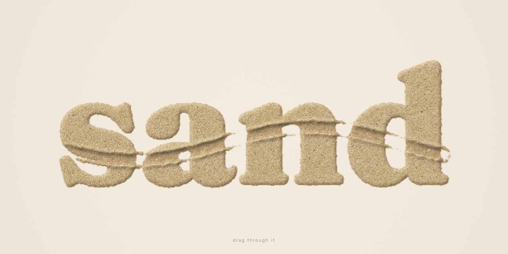

# sand



One huge word made of up to ~200,000 grains of sand. Press and drag through it like a finger in a sand tray: grains are shoved aside into crumbly berms, the trail leaves a shallow, streaked groove, quick flicks throw a few fine grains, and a moment after you stop, every grain slides back home until the word is perfect again. A soft brushing sound follows your finger.

Vite + React + TypeScript + Tailwind, with the effect itself in plain WebGL2.

```sh
pnpm install
pnpm dev      # http://localhost:5173
pnpm build
```

## How it works

- **Grains live on the GPU.** Each grain is one texel in float textures: position/velocity, state (hop height, free/resting, floor compaction) and home (rest position, depth in the bed, size). A fragment shader steps the simulation, so the CPU only feeds in the pointer path.
- **The finger is a moving capsule.** Each frame's pointer path, including coalesced events, is split into short segments, and the sim runs one substep per segment so fast strokes don't skip. The fingertip is a shallow dome, so it displaces the top of the bed deepest in the middle and barely at the rim. The bottom layers stay behind as a compacted floor with fine streaks along the stroke.
- **Piles behave like sand.** Grains are splatted into a height field every frame. Displaced grains creep downhill wherever the pile is steeper than the angle of repose, so berms slump into a natural profile and partly refill the groove. Pushed grains lose their momentum almost at once, as in dense sand. Only fast strokes flick a few of the finest grains out, on short hops.
- **Lighting comes from the same height field.** Diffuse light, a soft marched cast shadow and cavity occlusion give the groove walls, berms and letter edges their depth. Each grain is a tiny shaded bead with a contact shadow, over a darker bed that fills the gaps between grains.
- **Healing.** After about 1.1 s without movement, displaced grains glide home with staggered, eased motion. After 5.2 s everything snaps exactly to rest, and the render loop stops completely.
- **Sound.** Two noise layers are synthesized at startup: a rustling brush hiss and a stream of thousands of tiny grain ticks. Finger speed drives their level, brightness and tick rate, and they're silent unless there is sand under the finger. No audio files.

## Performance

- It renders at about 60 fps even on high refresh displays, by drawing on every 2nd/3rd/4th vsync to keep an even cadence.
- A full frame costs about 1.5–2 ms on an RTX 4060 at 2300×1294.
- Nothing runs while the word is at rest.

## Credits

The effect is written from scratch. It does not use, port or copy any effect library or existing demo. The general techniques it builds on are standard ones:

- GPU particle state in ping-pong float textures.
- Talus-angle ("thermal erosion") relaxation, from terrain generation (Musgrave, Kolb & Mace, 1989).
- Chris Wellons' `lowbias32` integer hash (in the shaders) and Marsaglia's xorshift PRNG.

The word is set in [Fraunces](https://github.com/undercasetype/Fraunces) by Undercase Type (SIL OFL), self-hosted via Fontsource.

These photos from Wikimedia Commons were used as visual references while tuning; they aren't included in the repo:

- "Writing on sand" by Belinda (CC0)
- "'Jump' written in the sand at Parc Güell" by Chris Koerner (CC BY 2.0)
- "A picture with the word Peace grafted into beach sand" by Yaw Kuma Ansu-Kyeremeh (CC BY-SA 4.0)

`og.png` (1280×640) is the GitHub social preview image.
